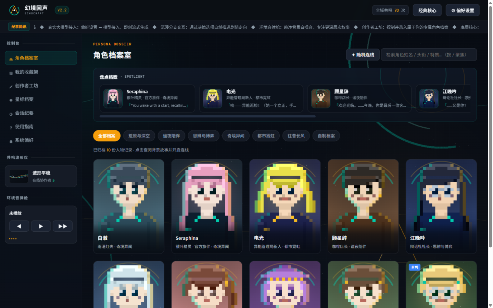
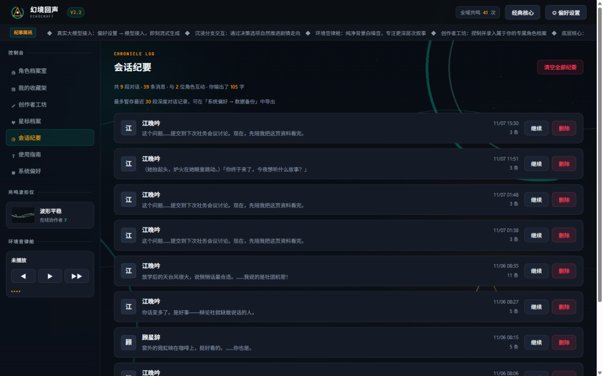

# 幻境回声 · EchoCraft

**沉浸式 AI 叙事沙龙** —— 基于 SillyTavern 1.19.0 二次开发的 AI 聊天陪伴网站，已上线 [ai-ic.top](https://ai-ic.top)。


角色卡库是全站唯一角色数据源：一份卡，门户（EchoCraft 沙龙）与经典酒馆（完整 SillyTavern）共用。全部角色文本、程序化肖像、环境音律与品牌资产为原创，无第三方素材依赖。

## 界面速览

| 角色档案室 | 会话纪要 |
|---|---|
|  |  |

## 特性

- **门户角色档案室**：24×28 程序化具象像素肖像（发型/瞳色/配饰随角色卡设定），全幅封面名册，深空回声场景背景
- **角色卡库单一数据源**：`data/default-user/characters/*.png`（chara_card_v2/v3）→ `tools/build-cards.mjs` 编译为门户数据；导出的 PNG 卡可放回卡库被直接识别
- **世界书 v1**：角色卡 extensions 内置设定集（关键词触发 + 核心条目兜底），随对话自动注入 AI 提示词；创作者工坊可视化编辑
- **双模对话**：BYOK 大模型流式对话（OpenAI 兼容，经服务端代理）+ 本地离线剧本引擎兜底（关键词应答/行动选项/剧情追踪）
- **程序化资产**：肖像引擎、环境音律发生器（7 首原创 WebAudio 音景）、品牌图腾与场景背景全部算法生成，零外部素材
- **多端适配**：桌面三栏 + 移动端底部导航，100+ 项冒烟断言持续护航

## 快速开始

```bash
npm install        # 安装依赖
npm start          # 启动，监听 8000 端口
```

三个入口：

| 地址 | 说明 |
|---|---|
| `http://127.0.0.1:8000` | EchoCraft 门户（角色档案室） |
| `http://127.0.0.1:8000/?classic=1` | 经典酒馆（完整 SillyTavern UI） |
| `http://127.0.0.1:8000/web/` | 发现页（静态导出） |

聊天需要接入模型：门户右上 ⚙ 偏好设置 → 模型接入，填入任意 OpenAI 兼容 API（Base URL + Key）；不填则使用离线剧本引擎。

## 改角色 / 加角色

```bash
node tools/make-demo-cards.mjs   # 编辑 tools/ 内卡内容源 → 重生成卡 PNG
node tools/build-cards.mjs       # 卡库 → 编译门户 cards.js
node tools/make-card-covers.mjs  # 重生成 /web 海报封面
node tools/make-portal-bg.mjs    # 重生成门户背景场景
node tools/smoke.mjs             # 冒烟测试（121 项断言）
```

也可以直接把任何 chara_card_v2 PNG 丢进 `data/default-user/characters/` 再跑 `build-cards`，或在浏览器「创作者工坊」里可视化构建。

## 部署

- **Vercel（零服务器）**：仓库已配置 `vercel.json`（门户路由）与 `api/pixel/*` Serverless 函数（对话代理/访问计数/SEO），推送即部署
- **VPS + Docker + Caddy**：完整套件见 [deploy/README-DEPLOY.md](deploy/README-DEPLOY.md)

## 目录速览

```
public/pixel-tavern/   # EchoCraft 门户（本次项目的主体 UI）
public/web/            # /web 发现页（Next.js 静态导出产物）
api/pixel/             # Vercel Serverless 函数（对话代理等）
data/default-user/     # 经典酒馆数据（角色卡库 / 会话 / 主题）
tools/                 # 卡库管线 / 资产生成器 / 冒烟测试
deploy/                # Docker + Caddy 部署套件
docs/CREDITS.md        # 素材来源与开源授权登记
```

## License

本项目衍生自 [SillyTavern](https://github.com/SillyTavern/SillyTavern)（AGPL-3.0），遵循同一授权发布。第三方素材来源与授权详见 [docs/CREDITS.md](docs/CREDITS.md)。
